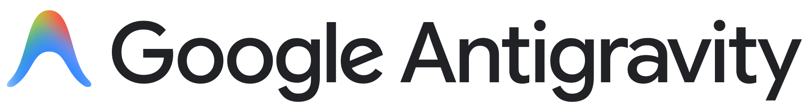
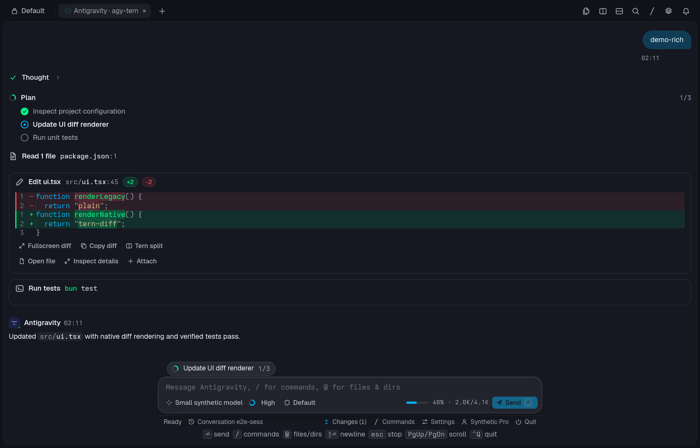
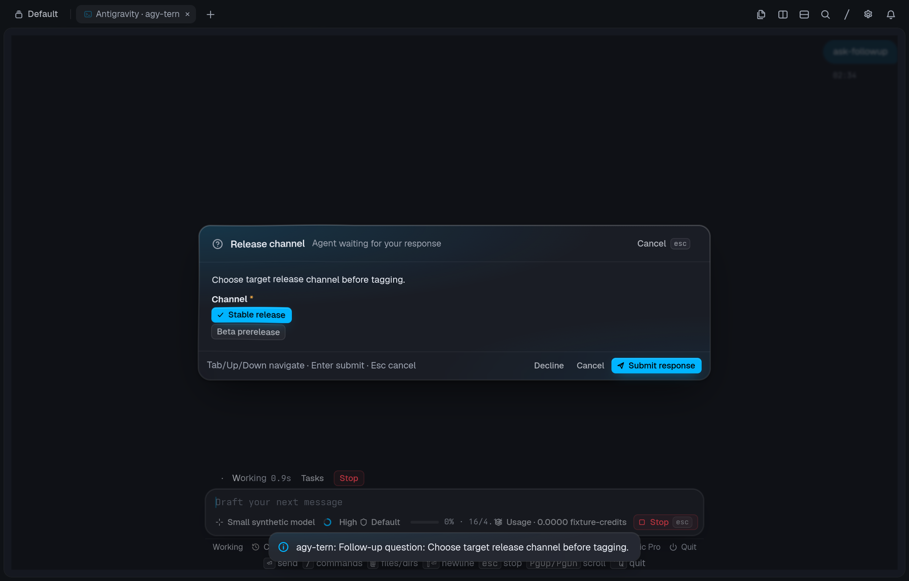
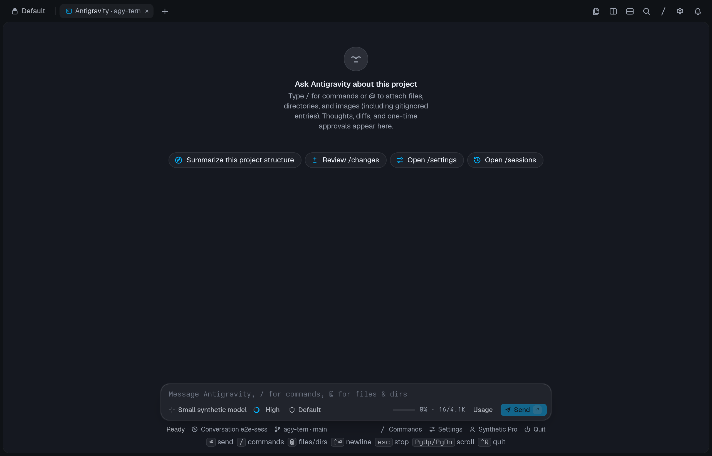

<p align="center">
  <picture>
    <source media="(prefers-color-scheme: dark)" srcset="assets/antigravity-lockup-dark.svg" />
    <source media="(prefers-color-scheme: light)" srcset="assets/antigravity-lockup.svg" />
    
  </picture>
</p>

# agy-tern

[](https://github.com/oktavsm/agy-tern/actions/workflows/ci.yml)
[](https://github.com/oktavsm/agy-tern/releases)
[](LICENSE)
[](https://bun.sh/)

Native [Tern](https://docs.stencil.so/tern/protocol/index.md) terminal frontend built for the official Antigravity CLI (`agy`) over the [Agent Client Protocol (ACP)](https://agentclientprotocol.com/).

`agy-tern` spawns `agy acp --sandbox` as a subprocess and renders streaming replies, collapsible reasoning traces, task plans, diffs, clickable tool outputs, media inspection, interactive follow-up modals, and explicit one-time approvals natively through the Tern Surface Protocol (TSP).

> **Third-party notice**: `agy-tern` is an independent open-source frontend, not an official Google or Stencil product. Authentication, credentials, model routing, tool execution, and Google API communication remain inside the official `agy` binary. Using the official CLI does not bypass account limits or quotas.

---

## Install (No `git clone` Needed)

Install the latest verified GitHub Release directly into `~/.local/share/agy-tern` and link `~/.local/bin/agy-tern` in one command:

```sh
curl -fsSL https://raw.githubusercontent.com/oktavsm/agy-tern/main/scripts/install.sh | bash
```

Prerequisites:
- [Bun](https://bun.sh/) `>= 1.2.22` (pass `AGY_TERN_INSTALL_BUN=1` before `curl` if you want the installer to set up Bun automatically)
- Official Antigravity CLI (`agy`) with `agy acp` support
- [Tern](https://docs.stencil.so/tern/protocol/index.md) terminal with Surface Protocol support (non-Tern terminals automatically fall back to `agy --sandbox`)

Sign in once through `agy` (`agy acp --login`, or inside `/account` on first launch), then start inside any project directory:

```sh
agy-tern
```

<details>
<summary>Alternative install, uninstall, and troubleshooting</summary>

- **Install a specific release tag**:
  ```sh
  curl -fsSL https://raw.githubusercontent.com/oktavsm/agy-tern/main/scripts/install.sh | bash -s -- --version v0.2.0
  ```
- **Install from a local git clone**:
  ```sh
  git clone https://github.com/oktavsm/agy-tern.git
  cd agy-tern
  ./scripts/install.sh
  ```
- **Uninstall**:
  ```sh
  curl -fsSL https://raw.githubusercontent.com/oktavsm/agy-tern/main/scripts/install.sh | bash -s -- --uninstall
  ```
- **`agy-tern: command not found`**: Add `~/.local/bin` to your shell `PATH`:
  ```sh
  export PATH="$HOME/.local/bin:$PATH"
  ```
- **Not authenticated**: Run `agy acp --login` in your shell or open `/account` inside `agy-tern`.
- **macOS clipboard image paste**: Install `pngpaste` (`brew install pngpaste`) for `Alt+V` / `/paste-image` (`pbcopy` handles text copy).
- **Linux clipboard copy/paste**: Install `wl-clipboard` (`wl-copy` / `wl-paste`) on Wayland or `xclip` on X11. If your window manager intercepts `Alt+V`, use `/paste-image` (`/clip`).

</details>

---

## Updating

`agy-tern` checks for new releases passively once every 24 hours on startup (showing a toast notification when an upgrade is published) and provides a built-in self-updater with SHA-256 checksum verification:

```sh
agy-tern update          # Download & install the latest verified release
agy-tern update --check  # Check if a newer release is available without modifying files
```

If you run `agy-tern` from a clean local git clone instead of a release archive, `agy-tern update` pulls fast-forward commits and rebuilds `dist/cli.js` automatically. Set `AGY_TERN_NO_UPDATE_CHECK=1` to silence the passive 24h startup check.

---

## Preview



<details>
<summary>More screenshots: Interactive follow-up modal & ready screen with chatbox Usage bar</summary>

**ACP Follow-Up Question Modal (`elicitation/create`)**



**Ready View & Clickable Usage Control Bar**



</details>

---

## Everyday Usage

Launch inside any workspace in Tern:

```sh
agy-tern                                          # Start a new interactive session in the current folder
agy-tern -c                                       # Resume the latest session in this workspace
agy-tern --cwd /path/to/repo --add-dir ../shared  # Workspace + extra context directories
agy-tern --model gemini-4-hydrogen --thinking high --mode plan
agy-tern --doctor                                 # Verify agy, tern, Bun, and clipboard setup
```

### Core Workflows

- **Startup & Turn Visibility**: Multi-stage connection progress (`Starting agy process (1/4)` through `Ready`), live `starburst` task indicator with elapsed time, and scrollable transcript with persistent draggable scrollbar.
- **Centered Rounded Composer**: Type messages normally, press `/` for slash commands, press `@` to attach tracked, untracked, or `[gitignored]` files and `@dir/` folders, and click **Usage** or model/effort/mode buttons directly inside the composer bar.
- **Clickable Tasks & Media**: Click any file-read task in the transcript to inspect the file in a centered modal; use inline pill actions (`Open file`, `Inspect`, `Inspect diff`, `Split`, `Copy`) on any tool step; paste screenshots with `Alt+V` or `/paste-image`.
- **Interactive Follow-Up Questions**: ACP `elicitation/create` prompts and `ask_question` follow-ups open in a centered interactive modal supporting single-select, multi-select, text/number/boolean inputs, and URL prompts.
- **Cross-Workspace Sessions & Chat Search (`/sessions`)**: Switch between **`This folder`**, **`All workspaces`** (sessions from any folder reported by `agy`, showing each session's origin workspace), and **`Local named`**. Search matches **titles, local labels, folder names, session IDs, and cached chat message content** (`Chat match`).
- **Usage & Account Details (`/usage`, `/account`)**: View quota meters and reset timers alongside ACP context token metrics and the **`Details`** tab (tier, auth boundary, sign-in method, active session runtime, model/thinking/mode, capabilities, and remaining context tokens).
- **One-Time Safety Approvals**: Tool permission requests show diffs and commands inline. Use `Tab`, `Ctrl+Y` (allow once), and `Ctrl+N` (deny); `Enter` never approves a tool call.

<details>
<summary>CLI Flags Reference</summary>

| Flag / Command | Description |
| --- | --- |
| `update [--check] [--force] [--version TAG]` | Check or install the latest verified release from GitHub Releases |
| `--cwd <dir>` | Set primary workspace directory |
| `--add-dir <dir>` | Attach an additional workspace root (repeatable; forwarded to `agy` and indexed for `@file`) |
| `--agent <name>` | Select configured custom `agy` agent profile |
| `--model <id\|name>` | Apply initial ACP `model` session option once connected |
| `--mode <id\|name>` | Apply initial ACP `mode` session option once connected |
| `--thinking`, `--effort <level>` | Apply initial ACP reasoning effort option |
| `--append-system-prompt <text>` | Append instructions via ACP session metadata when advertised |
| `--max-fps <5-60>` | Cap streaming frame rate (default `25`; lower values like `15` save CPU/battery) |
| `--motion <auto\|full\|reduced>` | Override animation preference (`reduced` limits cadence to <=12 FPS) |
| `-c`, `--continue` | Resume the most recent ACP session in this workspace |
| `--conversation <id>` | Load a specific saved ACP session ID |
| `-i`, `--prompt-interactive`, `[PROMPT]` | Start interactively with an initial prompt |
| `--agy <path>` | Override the `agy` executable path (absolute or `PATH`-resolved) |
| `--doctor [--json]` | Verify `agy`, `tern`, clipboard tools, and launcher symlink |
| `-V`, `--version` | Print installed `agy-tern` version |
| `-h`, `--help` | Show CLI usage help |

</details>

<details>
<summary>Keyboard Controls & Slash Commands</summary>

**Keyboard Controls**:
- **Send / Queue**: `Enter` sends (or queues follow-up prompts while busy); `Shift+Enter` inserts a newline; multiline pastes stay in the draft.
- **Composer Editing**: `Ctrl+A` / `Ctrl+E` (line start/end), `Ctrl+Left`/`Right` or `Alt+B`/`F` (word jump), `Up`/`Down` (wrapped lines or prompt history `History i/N`), `Ctrl+W`/`U`/`K`, `Ctrl+Z` (undo).
- **Quick Panels & Session Tabs**: `Ctrl+K` opens the command palette, `Ctrl+Tab` / `Alt+1..6` switch between open session tabs, and `/keys` shows the full shortcut reference.
- **Modals & Turns**: `Esc` closes overlays without cancelling a running turn; during an active turn with no modal open, `Esc` cancels the turn. `Ctrl+Q` quits cleanly.
- **Transcript & Inspector**: `PgUp` / `PgDn` or mouse wheel / scrollbar drag scroll history; inside `InspectOverlay`, use `Up`/`Down`/`PgUp`/`PgDn`/`Home`/`End` to scroll, `c` to copy, `l` to toggle diff layout, `a` to attach, `s` to open in Tern split, and `u`/`Backspace` to go up a directory.

**Slash Commands**:

| Command | Behavior |
| --- | --- |
| `/sessions`, `/resume`, `/switch` | Browse `This folder`, `All workspaces`, and `Local named` sessions; search by title, folder, ID, or chat text; load, fast-resume, rename, or close |
| `/turns`, `/outline` | Browse conversation turns, filter pinned turns, reuse prompts, or jump directly to any turn |
| `/queue` | Inspect, reorder (`Move up`/`Move down`), edit in draft, or drop queued follow-up prompts |
| `/usage`, `/quota` | Official `/usage` quota table, ACP context telemetry, and **`Details`** account/runtime view |
| `/model [id\|name]` | Switch active ACP model |
| `/settings`, `/config` | Open 4-page `<prefs>` modal persisted in `$XDG_STATE_HOME/agy-tern/prefs.json` |
| `/find [query]`, `/search [query]` | Search transcript messages, thoughts, tools, diffs, plans, and notices |
| `/changes`, `/diff` | Inspect session edits and workspace `git status` diffs; stage, unstage, discard (confirmed), copy diff, or open in `Tern split` |
| `/tasks`, `/running`, `/ps` | Inspect live child processes and tool activity, view live streaming command output (`Enter`), or kill running processes |
| `/templates [query]` | Save, search, insert, or delete workspace prompt templates |
| `/mcp`, `/plugins`, `/agents` | Manage `agy` MCP servers, plugins/skills, and custom agent profiles |
| `/new`, `/rename [name]` | Start a new session or set a local display label |
| `/export [file.md\|json]` | Export transcript as Markdown or JSON inside the workspace |
| `/expand`, `/collapse` | Expand or collapse all thought and tool cards |
| `/paste-image`, `/clip` | Attach clipboard image (`Alt+V`) |
| `/credits`, `/changelog`, `/account`, `/permissions`, `/help`, `/quit` | Official reports, sign-in/switch flow, capability audit, command catalog, exit |

</details>

---

## Platform Support Matrix

| Platform | Status | Notes |
| --- | --- | --- |
| Linux (`x86_64` / `arm64`) | Verified | Primary development target; full unit + PTY Tern E2E CI suite (`wl-copy`/`wl-paste` or `xclip`) |
| macOS (`darwin`) | Experimental | Unit tests & production build verified on `macos-latest` CI; uses `pbcopy` and `pngpaste`; interactive Tern checks unverified in CI |
| Windows (via WSL2) | Supported | Run inside WSL2 Linux with Bun, `agy`, and Tern |
| Windows (native) | Unsupported | Relies on POSIX PTYs, POSIX `/bin/sh -lc` splits, and Unix terminal utilities |

---

## Trust Boundary & Local State

- **Subprocess isolation boundary**: `agy-tern` passes `--sandbox` to `agy acp --sandbox`, does not implement its own filesystem or terminal RPC servers, and never passes permission-bypass flags. Requesting `--sandbox` does not verify OS-level kernel containment unless enforced by `agy` on your host.
- **Zero credential storage**: No tokens, OAuth state, or account pools are stored by `agy-tern`. Official login/logout modifies `agy`'s shared authentication across CLI, Desktop App, and IDE extensions.
- **Explicit approvals**: Tool permission prompts allow only `allow_once` or `reject_once` choices using server-provided option IDs. Pre-existing `agy` allow rules still apply inside the backend subprocess.
- **Local XDG state (`0700` dir / `0600` file)**: UI preferences (`prefs.json`), private session labels (`session-names/`), prompt history (`prompt-history/`), sanitized UI transcript snapshots (`transcripts/`), prompt templates (`templates/`), and passive update check cache (`update-check.json`) live under `$XDG_STATE_HOME/agy-tern/` (default `~/.local/state/agy-tern/`). Standalone releases install under `$XDG_DATA_HOME/agy-tern/` (default `~/.local/share/agy-tern/`).

---

## Development & Verification

```sh
bun install --frozen-lockfile
bun run typecheck
bun test
bun run build
bun run dist/cli.js --doctor
```

Core module map:
- `src/contracts.ts`, `src/agent.ts`, `src/auth.ts`, `src/reports.ts`: Official ACP stdio boundary, login lifecycle, and CLI reports.
- `src/model.ts`, `src/history.ts`, `src/session-state.ts`, `src/draft.ts`, `src/files.ts`, `src/prefs.ts`, `src/session-names.ts`, `src/templates.ts`: Transcript hydration, local XDG stores, composer input, and `@file` indexing.
- `src/cli-args.ts`, `src/cli.tsx`, `src/updater.ts`, `src/commands.ts`, `src/extensions.ts`, `src/task-monitor.ts`, `src/tern-window.ts`: CLI flag parsing, `update` & passive check, extension managers, live child process monitor, `tern open` splits, and OSC 9 attention alerts.
- `src/tern-render.ts`, `src/ui-format.ts`, `src/context-budget.ts`, `src/turn-outline.ts`, `src/ui-session-helpers.ts`, `src/picker-nav.ts`, `src/transcript-view.tsx`, `src/panels.tsx`, `src/ui.tsx`: Adaptive Tern render controller, pre-send context estimator, turn outline, modal pickers, inspector overlays, composer card, and keyboard/pointer orchestration.

---

## Contributing & License

Contributions are welcome. Read [CONTRIBUTING.md](CONTRIBUTING.md), [CODE_OF_CONDUCT.md](CODE_OF_CONDUCT.md), [AGENTS.md](AGENTS.md), and [SECURITY.md](SECURITY.md) before opening a pull request or reporting security issues. See [CHANGELOG.md](CHANGELOG.md) for release notes.

Licensed under the [MIT License](LICENSE).
